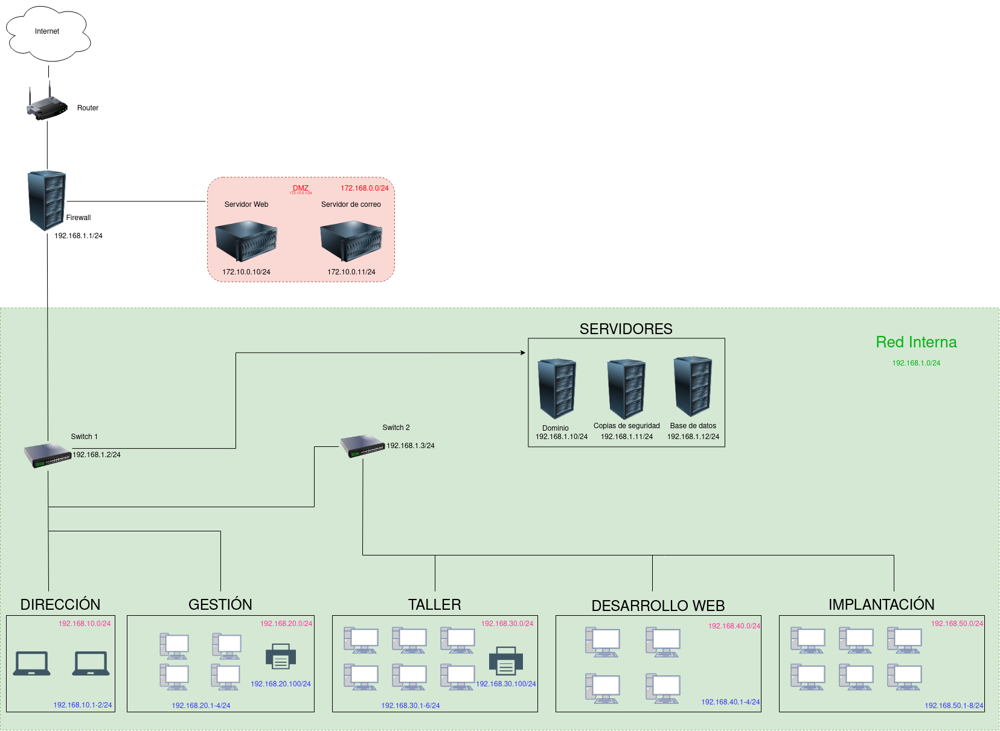

# Diseño de la infraestructura y diagrama de red

## Diagrama de red

## Zonas de la red

La red está dividida en tres zonas, separadas por el firewall:

| Zona | Red | Qué contiene | ¿Visible desde Internet? |
|------|-----|--------------|--------------------------|
| Externa (WAN) | 10.0.2.0/24 | Router de salida a Internet | — |
| DMZ | 172.16.0.0/24 | Servidor web y servidor de correo | Sí, solo estos dos |
| Red interna (LAN) | 192.168.1.0/24 | Servidores internos, ordenadores e impresoras | No |

## Funciones de los componentes

| Componente | Dirección | Función |
|------------|-----------|---------|
| Router | 10.0.2.2 | Salida a Internet. En el entorno de pruebas lo proporciona el NAT de VirtualBox |
| Firewall | WAN 10.0.2.15 · LAN 192.168.1.1 · DMZ 172.16.0.1 | Separa las tres zonas, hace NAT, filtra el tráfico y es la puerta de enlace de la red interna |
| Servidor web | 172.16.0.10 | Aloja la web corporativa y los servicios online para clientes |
| Servidor de correo | 172.16.0.11 | Envía y recibe el correo de la empresa |
| Switch de 32 puertos | — | Une todos los equipos de la red interna |
| Servidor de dominio | 192.168.1.10 | Usuarios, permisos y DNS interno |
| NAS de copias | 192.168.1.11 | Carpetas compartidas y copias de seguridad en RAID |
| Equipos cliente | 192.168.1.20 – .67 | Puestos de trabajo de los cinco departamentos |
| Impresoras | 192.168.1.39 y .49 | Impresión en red para Gestión y para Taller |

## Conexiones

- El **router** se conecta al puerto WAN del **firewall**, que recibe la dirección 10.0.2.15 por DHCP.
- El **firewall** tiene dos puertos más: uno hacia la **DMZ** (172.16.0.1) y otro hacia la **red interna** (192.168.1.1).
- El puerto LAN del firewall se conecta al **puerto 1 del switch**.
- Del **switch** salen el resto de conexiones, repartidas por departamento:

| Puertos | Equipos conectados |
|---------|--------------------|
| 1 | Firewall |
| 2 – 3 | Servidor de dominio y NAS de copias |
| 4 – 5 | Dirección (2 equipos) |
| 6 – 10 | Gestión (4 equipos + impresora) |
| 11 – 17 | Taller (6 equipos + impresora) |
| 18 – 21 | Desarrollo web (4 equipos) |
| 22 – 29 | Implantación (8 equipos) |
| 30 – 32 | Libres, para crecer |

Los **servidores de la DMZ no se conectan al switch**: cuelgan directamente del puerto DMZ del firewall, que es lo que los mantiene separados de la red interna.

## Decisiones técnicas

- **Topología en estrella.** Todos los equipos de la red interna se conectan a un switch central. Es fácil de ampliar y, si falla un cable, solo afecta a un equipo.
- **Una sola red interna.** Con 24 trabajadores no compensa dividir la empresa en varias redes. Los 29 equipos caben de sobra en una red /24, que admite 254, y la configuración es mucho más sencilla. El orden se mantiene reservando un rango de direcciones a cada departamento.
- **Direcciones fijas en toda la red interna.** Cada equipo tiene siempre la misma dirección. Así sabemos en todo momento qué equipo es cada IP, lo que facilita el soporte y la aplicación de reglas en el firewall. Con 29 equipos es perfectamente manejable.
- **El firewall es la puerta de enlace.** Al haber una sola red interna no hace falta un switch de nivel 3 que enrute entre redes: los equipos hablan entre ellos directamente por el switch, y solo pasan por el firewall cuando salen a Internet o a la DMZ.
- **Switch de 32 puertos gestionable.** Cubre los 29 equipos actuales y deja 3 puertos libres. Al ser gestionable permite ver el estado de los puertos y, si la empresa creciera, separar departamentos en VLAN sin cambiar el cableado.
- **DMZ en una red distinta (172.16.0.0/24).** Usar otra numeración deja claro que no forma parte de la red interna y evita cualquier confusión al escribir las reglas del firewall.
- **DNS interno en el servidor de dominio.** Todos los equipos preguntan a 192.168.1.10, que resuelve los nombres de la empresa y reenvía a 8.8.8.8 lo que no conoce. Los servidores de la DMZ usan directamente 8.8.8.8, porque no deben depender de la red interna.
- **Sin Wi-Fi.** Todos los puestos son fijos y van por cable. No instalar Wi-Fi abarata la instalación y elimina una vía de entrada a la red.

## Servicios en la DMZ y por qué

| Servicio | Dirección | Por qué está en la DMZ |
|----------|-----------|------------------------|
| Servidor web | 172.16.0.10 | Los clientes tienen que entrar desde Internet para ver la web y usar los servicios online |
| Servidor de correo | 172.16.0.11 | Tiene que recibir correo de servidores de fuera de la empresa |

Estos dos servidores están en la DMZ precisamente porque **tienen que ser accesibles desde Internet**, y eso los convierte en los equipos más expuestos de la empresa.

Si alguien consigue entrar en uno de ellos, el firewall impide que desde ahí alcance la red interna, donde están el dominio, las carpetas compartidas y las copias de seguridad. Por eso el servidor de dominio y el NAS están en la LAN y no se ven desde Internet.

Las reglas del firewall quedan así:

| Origen | Destino | Permitido |
|--------|---------|-----------|
| Internet | DMZ | Solo HTTP, HTTPS y los puertos de correo |
| Internet | LAN | Nada |
| LAN | DMZ | Sí, para administrar los servidores |
| DMZ | LAN | Nada |
| LAN | Internet | Sí, con NAT |

## Fuentes técnicas consultadas

- Cisco Networking Academy: material del curso CCNA sobre topologías, switching y diseño de redes de área local.
- Documentación de Netgate sobre pfSense: configuración de interfaces WAN, LAN y DMZ, NAT y reglas de filtrado.
- Documentación de Fortinet sobre el modelo FortiGate elegido: puertos, NAT y zonas de seguridad.
- Documentación de Microsoft sobre Active Directory Domain Services y el servicio DNS en Windows Server.
- Documentación de Canonical sobre Ubuntu Server: despliegue de servidor web y de servidor de correo.
- Manual de VirtualBox sobre el modo NAT y las redes internas, para el entorno de pruebas.
- Norma ISO/IEC 11801 y estándar IEEE 802.3 sobre cableado estructurado y longitudes máximas del par trenzado.
- Documentos del propio proyecto: `01-necessitats.md`, `04-adrecament-ip.md` y `05-recursos.md`.